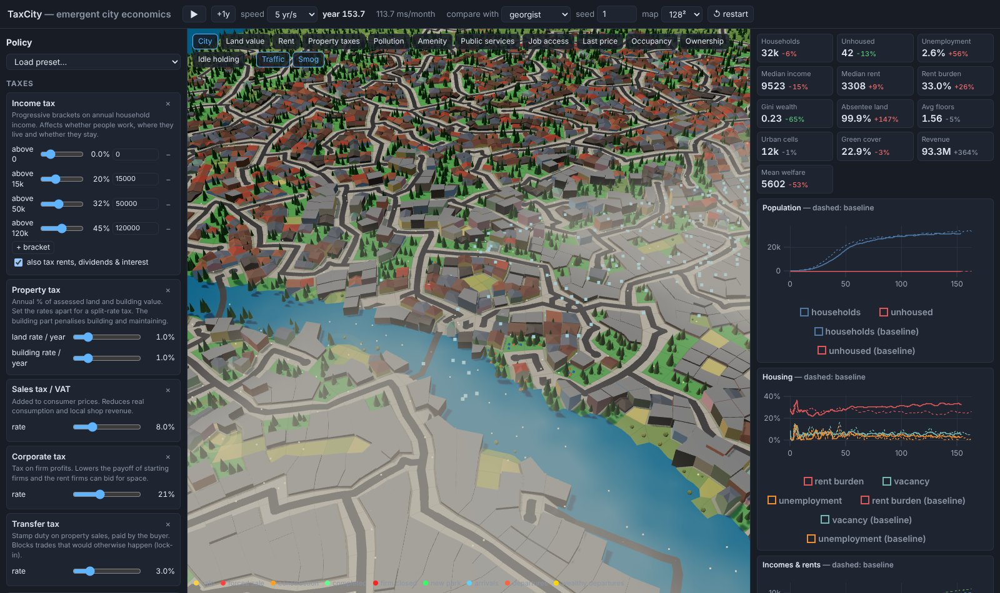
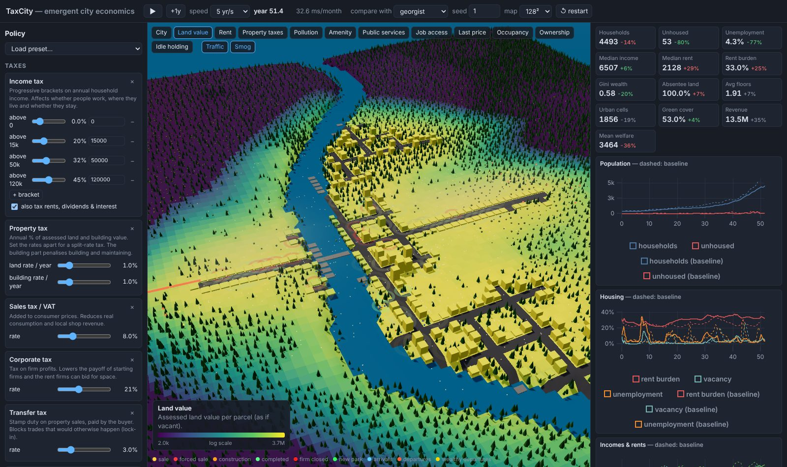

# TaxCity

An interactive, agent-based 3D city that grows out of individual decisions. Use it to explore how different
**tax regimes** shape a city: Georgist land value tax, income tax (flat or progressive), wealth tax, property
and split-rate tax, sales/VAT, corporate and payroll tax, transfer tax, Harberger (COST) tax, pollution tax,
vacancy, estate and head taxes, and how the revenue is spent (services, roads, parks, citizen's dividend, welfare).



The simulator does **not** encode what the literature predicts. Households, firms, landlords, developers and a
government follow simple rules. Every tax reaches them only through their own after-tax calculations: whether to
work, where to live, what to build and how tall, whether to hold land idle, whether to maintain a building, and
whether to stay in the city. Land prices, rents, sprawl, inequality, vacancy, decay, homelessness and capital
flight all *emerge* from those rules, and you can watch them happen:

* tall buildings or sprawl into the forest, fenced idle lots, cranes, boarded-up derelict buildings, tents;
* commuter traffic, families arriving and leaving (wealthy departures in gold), smog drifting from industry;
* land-value, rent, tax, pollution, amenity, ownership and speculation overlays;
* a parcel inspector showing owners, tenants, finances and the owner's best development option;
* side-by-side comparison against a baseline regime run from the same random seed.



## Quick start

Requirements: Rust (stable) with the `wasm32-unknown-unknown` target, and Node 20+.

```sh
rustup target add wasm32-unknown-unknown
cd web
npm install
npm run dev        # builds the wasm module and starts Vite on http://localhost:5173
```

`npm run build` produces a static site in `web/dist/` that runs on any static host (no special headers needed).

### Deploying to Cloudflare Workers

`wrangler.jsonc` defines a static-assets-only Worker that serves `web/dist`. With Workers Builds (Git integration),
use the repository root as the root directory and:

* **Build command:** `bash scripts/build-web.sh`. It installs a minimal Rust toolchain if the build image
  has none, then runs `npm ci && npm run build` in `web/`.
* **Deploy command:** `npx wrangler deploy`

Locally: `bash scripts/build-web.sh && npx wrangler deploy`.

### Headless experiments

The same simulation core compiles natively, for fast batch experiments:

```sh
cargo run --release -p sim-cli -- presets
cargo run --release -p sim-cli -- run --preset georgist --years 40 --csv georgist.csv
cargo run --release -p sim-cli -- compare --presets status_quo,georgist,wealth_tax --years 40 --seeds 10
```

`compare` runs every (preset, seed) pair in parallel on all cores and prints final-year indicators as mean ±
standard error across seeds. Runs are deterministic: the same seed and policy always give the same history.
Use many seeds before drawing conclusions. A single run is one stochastic history, and cities differ a lot by terrain.

To check that a run stays plausible, `audit` prints a detailed state report (land uses, households, firms,
public finances, money flows) every `--every` years and runs plausibility checks every year: tax revenue against
output, taxes on property against the rent it earns, empty business space, unhoused households, hoarded or
runaway public money, and bookkeeping invariants. It exits non-zero if any check fails:

```sh
cargo run --release -p sim-cli -- audit --preset georgist --years 500 --every 50
```

## Repository layout

```
crates/sim-core   platform-independent simulation (Rust): agents, markets, taxes, metrics
crates/sim-wasm   tiny C-ABI wrapper compiled to WebAssembly for the browser
crates/sim-cli    `taxsim`: native headless runner, CSV output, parallel preset comparison
web/              Vite + TypeScript + Three.js front end; the simulation runs in a Web Worker
docs/             architecture, model specification, research notes
```

## Documentation

* [docs/architecture.md](docs/architecture.md): technology choices, data flow and how to extend (new tax, system, overlay).
* [docs/model.md](docs/model.md): the economic model: agents, decision rules, markets, taxes, indicators, limits.
* [docs/research/economics.md](docs/research/economics.md): literature review: tax incidence, urban ABMs, KPIs, scope.
* [docs/research/technology.md](docs/research/technology.md): WebAssembly vs JS vs native, rendering, benchmarks.

## Tests

```sh
cargo test --release              # unit tests + mechanism invariance tests
cd web && npm run build && npm run smoke   # headless browser smoke test (set CHROMIUM=/path/to/chrome)
```

The mechanism tests check properties the model must have by construction:
* deterministic replay;
* a lump-sum tax never changes development choices;
* a land value tax never changes the chosen building height;
* a building tax never raises it;
* land taxes capitalize into land values;
* private development never builds on the mapped street plan;
* a road blocked by a building expropriates it at full compensation;
* long runs stay finite;
* a city grown for 60 years passes every audit check;
* land without street access is assessed as farmland, and shop sales per worker are bounded.
